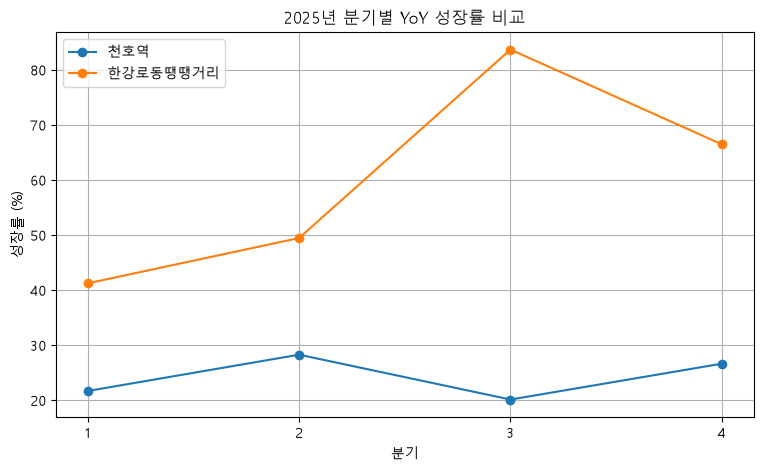
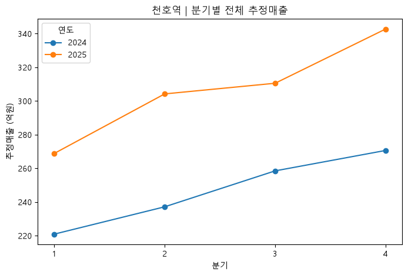
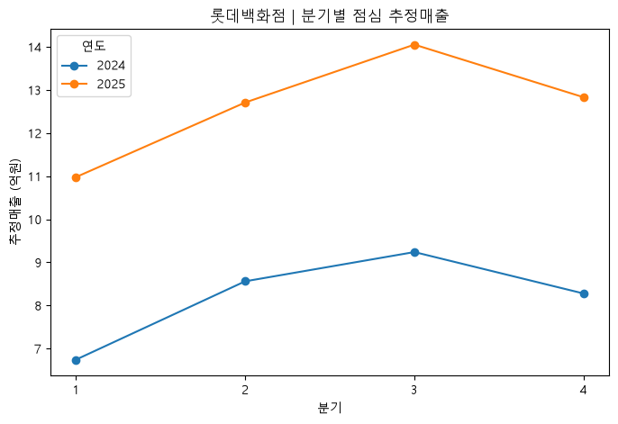
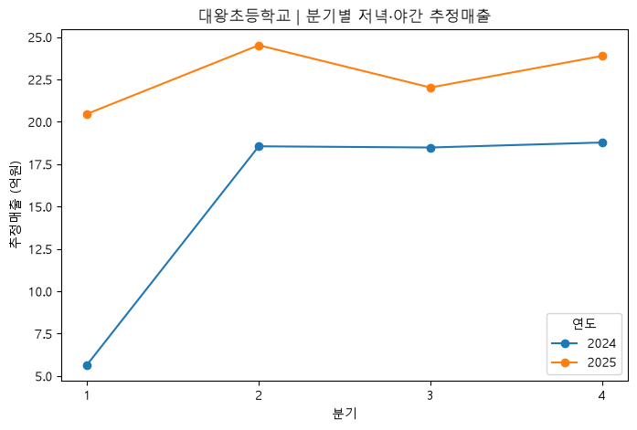

# 서울시 한식음식점 상권 성장 분석

> **매출이 성장하는 상권이라면, 어디에 창업해야 할까?**  
> 서울시 한식음식점의 매출 성장성과 시간대별 수요를 분석해 영업 전략별 입점 검토 상권 3곳을 제안한 데이터 분석 프로젝트입니다.

## 프로젝트 개요

| 항목 | 내용 |
| --- | --- |
| 분석 대상 | 서울시 한식음식점 (`CS100001`) |
| 데이터 | 서울시 상권분석서비스 추정매출·점포 데이터 |
| 분석 기간 | 2023년 1분기 ~ 2025년 4분기 (핵심 비교: 2024~2025년) |
| 기술 스택 | Python, Pandas, NumPy, Matplotlib, Jupyter Notebook |
| 분석 목적 | 전체·점포당 매출과 분기별 성장성을 검증하고 영업 방식별 입점 검토 후보 제안 |

## 주요 분석 결과

| 단계 | 결과 |
| --- | ---: |
| 2024~2025년 8개 분기 자료 및 기본 조건 충족 | 947개 상권 |
| 전체·점포당 연간 추정매출 증가 및 2025년 4개 분기 전체 YoY 양수 | **120개 성장 상권** |
| 최근 YoY 성장률 개선·유지 / 둔화 | **28개 / 92개** |
| 종합 성장형 비교 후보 | **29개** |
| 점심 성장형 비교 후보 | **17개** |
| 저녁·야간 성장형 비교 후보 | **19개** |

> 유형별 비교 후보 29+17+19는 **유형 간 중복 가능한 65개 후보 항목**이며 서로 다른 상권 65개를 뜻하지 않습니다.

### 영업 전략별 최종 입점 검토 후보

| 유형 | 상권 | 2025년 해당 매출 성장률 | 2025년 점포당 해당 추정매출 | 최근 Q3→Q4 YoY 변화 |
| --- | --- | ---: | ---: | ---: |
| 종합 성장형 | 천호역 | **+24.23%** (전체) | 11.25억 원 | **+6.52%p** |
| 점심 성장형 | 롯데백화점(시청광장 지하쇼핑센터) | **+54.08%** (점심) | 2.20억 원 | **+2.92%p** |
| 저녁·야간 성장형 | 대왕초등학교(세곡동사거리서남측) | **+47.85%** (저녁·야간) | 7.74억 원 | **+8.06%p** |

세 상권은 **수익성이나 투자 우선순위가 아니라 영업 방식에 따른 대안**입니다. 서로 다른 시간대의 성장률 및 매출액을 단순한 우열 비교에 사용하지 않습니다.

## 시각화

**2025년 분기별 전체 매출 YoY 성장률: 한강로동땡땡거리 vs 천호역**

| 천호역: 전체 추정매출 | 롯데백화점: 점심 추정매출 |
| --- | --- |
|  |  |

**대왕초등학교: 저녁·야간 추정매출**

## 분석 기준

1. 2024년과 2025년 모두 **4개 분기 자료**가 있는 상권을 대상으로 합니다.
2. 두 연도의 평균 점포수가 각각 **10개 이상**, 2024년 전체 추정매출이 **0보다 큰** 상권을 대상으로 합니다.
3. **2025년 연간 전체 추정매출과 점포당 추정매출이 모두 증가**하고, **2025년 4개 분기 각각의 전체 매출 YoY가 양수**인 상권을 성장 상권으로 선정합니다.
4. 성장 상권 내에서 점심(11–14시)과 저녁·야간(17–24시)의 2025년 **4개 분기 YoY 양수** 조건을 각각 적용합니다.
5. 유형별로 **연간 해당 시간대 성장률과 점포당 해당 시간대 추정매출이 각각 유형 내 중앙값 이상**인 상권을 추가 비교합니다.
6. 최종 후보는 분기별 성장 지속성, 최근 성장률 변화, 매출 집중도 및 기저효과 등을 함께 검토한 **대표 사례**입니다.

**단위 및 계산:** 원본의 `당월_매출_금액`은 분기 안의 **월평균 추정매출**이므로, 분기 환산 추정매출(억 원)은 `당월_매출_금액 × 3 ÷ 100,000,000`으로 계산합니다. 연간 추정매출은 분기 환산 매출 4개 합계, 점포당 연간 추정매출은 연간 매출을 해당 연도의 평균 점포수로 나눈 값입니다. **실측 개별 점포 매출이나 순이익을 의미하지 않습니다.**

## 추가 검증과 해석상의 한계

- 롯데백화점 상권은 **2024년 대비 평균 점포수 -10.68%**였으므로 점포수 감소 원인과 신규 입점 가능성을 확인해야 합니다.
- 대왕초등학교 상권은 2024년 1분기의 낮은 매출에 따른 기저효과를 고려해야 합니다. 해당 1분기를 제외한 **2~4분기 저녁·야간 추정매출은 +26.18%** 증가했습니다.
- 추정매출만으로 임대료·인건비·식재료비를 반영한 **창업 수익성을 판단할 수 없습니다**. 입점 전 점포·임대 조건, 동선, 경쟁 환경 및 수요를 현장에서 검증해야 합니다.
- 2023년 자료는 장기 흐름을 확인하는 보조 자료이며, 최근 성장 상권 선별은 **2024~2025년**을 기준으로 합니다.